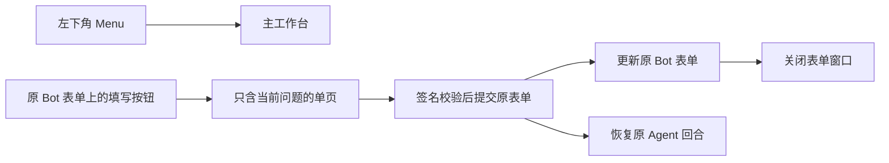

# Telegram 能力盘点与 XGent 改进清单

核查日期：2026-10-30。本文是官方能力核查和落地设计；表中“待接入”尚未成为运行功能。

官方当前 Bot API 是 **10.3（2026-08-24）**。10.1 引入富文本消息，10.2 增加显式媒体和结构化块，10.3 补上可折叠引用、正文按钮、文件块与原生停止事件。另外，Telegram Serverless 在 **2026-10-06** 更新了 Mini App 托管与后端端点，它是独立平台更新，不能算成 Bot API 11。

## 最值得接进本项目的功能

优先级：P0 为当前聊天、表单流程的直接改进；P1 为随后补齐；P2 为有对应使用需求时接入。已用、部分使用、待接入均以当前代码为准，服务器实际安装版本仍需部署时确认。

| 能力 | 当前情况 | 放进 XGent 后的具体变化 | 优先级 |
| --- | --- | --- | --- |
| 独立表单 Mini App | 主 Web 已有 `ask-x` 表单，Bot 仍逐项发消息录入 | 原 Bot 表单带一个“填写表单”按钮，弹出只含当前问题的小页面；选项、自定义、密钥一起填写，一次提交，更新原表单 | P0 |
| 原生流式草稿 | 有 Rich Draft 辅助代码，但当前显示路径禁用 | 前台流式在原生草稿中更新；结束后持久发送正式回复，减少反复编辑占位消息。后台流式与非流式仍按现有设置工作 | P0 |
| 真正接通 Rich Message | 有发送辅助函数，折叠模式强制回到普通 HTML | 长回复可达 32768 字符，表格成为真实表格，标题和列表按原生格式显示；同一条回复少拆续段 | P0 |
| 新版富文本可折叠引用 | 已用普通消息的原生引用折叠，Rich 路径未接 | 富文本也能沿用现有折叠设计；工具仍各发各的，保持 50 行与现有字符预算 | P0，随 Rich 接入 |
| 原生草稿停止事件 | 未处理 `stopped_message_generation` | 将原生停止事件绑定确切 `run_id`，取消对应模型请求并保存已有正文。命令块继续用“❌ 停止回答” | P1，先接正确事件路径 |
| Bot 私聊原生话题 | 项目已有独立会话，未使用 Telegram 话题 | 对话 A/B 在 Telegram 中成为独立话题；入站、回复、命令、表单都按话题映射到原有会话 | P1 |
| 原生复制按钮 | 未接，按钮转存会丢失 `copy_text` | 一键复制短命令、路径、标识；长回复仍用客户端复制或独立阅读页的复制全文 | P1 |
| 正文内轻量按钮、禁用状态 | 只转存回调、URL 与 Web App URL | 常用后续操作贴近正文，提交时原按钮暂时禁用；完成消息移除停止按钮，不把失效按钮留在历史 | P1 |
| 主 App 菜单按钮 | 已有“打开网页版”内嵌按钮，未发现程序配置 Menu Button | 左下角固定打开主工作台，当前消息的表单按钮只打开对应表单；支持读取已有 BotFather 配置 | P1 |
| Mini App 原生底部按钮、安全边距与关闭保护 | 已用免密登录、展开和部分震动，其余未接 | 原生“提交／取消”、提交进度；键盘和导航栏不挡住字段，普通草稿没保存时关闭会提醒 | P0，随表单接入 |
| 原生文件下载 | Web 已有上传、下载，未使用 `downloadFile` | 报告或备份可通过 Telegram 原生下载窗口保存；复用现有文件权限，提供短时下载地址 | P1 |
| 精确回复引用、阶段状态和轻量反馈 | 入站引用、回调提示与部分上传状态已用，出口未完整接 | 回复能定位原问题；“已保存”留在按钮状态或回调提示里；上传阶段显示上传状态 | P1 |
| 设置、任务与文件的独立小页面 | 当前主要通过多级消息菜单操作 | 常用开关继续留在 Bot；复杂模型列表、任务筛选和文件管理在专门页面完成，减少菜单翻页 | P2 |
| Inline 搜索／分享与深链接 | 无 Inline 查询处理器；`/start` 未做业务参数路由 | 输入 `@bot` 搜索可分享的回复或模板；点链接直接打开指定会话、任务、表单或只读报告 | P2 |

优先实施“表单小页面 + Mini App 原生交互”，然后接通“富文本 + 草稿的统一出口”，再做私聊话题。表单可以先使用现有普通 Bot 消息按钮，无须等待 Rich 接入。

## 代码里已经找到的具体缺口

| 接线点 | 现状和应改之处 |
| --- | --- |
| [`sections/rendering.py`](../xgent_app/sections/rendering.py) 的 `TelegramRichAPI` | 目前只传 `rich_message.markdown`；没有 HTML、结构化块、显式媒体、话题或原生停止参数的完整通路 |
| 同文件 `rich_finalize_text_response`、`TelegramStreamRenderer` | 当前 `_should_hide_protocol_blocks()` 恒为真，`_force_html` 因此禁用 Rich；`MirrorBot` 的 Web 标记也会禁用直连 Rich 路径。注释里“富文本不支持可折叠引用”的判断在 10.3 已过时 |
| [`presentation_delivery.py`](../xgent_app/presentation_delivery.py)、[`web_bridge.py`](../xgent_app/web_bridge.py)、[`fanout.py`](../xgent_app/fanout.py) | 当前正常发送有持久投递、重试和逻辑／原生 ID 映射。旧 Rich 辅助函数直连 API，绕过这条通路；接新版应在统一 Telegram 出口里完成 |
| `web_bridge.py` 的 `_markup_to_frame`／`markup_from_frame` | 只保留回调、URL 和 Web App URL。`copy_text`、`style`、`disabled`、自定义图标、Inline 查询和登录按钮等字段会丢失；单纯给按钮加字段仍不能正常投递 |
| [`sections/runtime.py`](../xgent_app/sections/runtime.py) | 已接文本、文件、图片、贴纸、原生音视频和回调；未接原生停止事件、Inline 查询、话题业务路由。长轮询未显式配置新版更新类型 |
| [`sections/messages.py`](../xgent_app/sections/messages.py) 的 Rich 入站解析 | 已能读一部分段落、表格和列表；未知块会递归捡字符串，还打印较完整的原始内容。需按正式类型提取正文、媒体与引用，避免把按钮数据或技术标识当成用户话语 |
| [`sections/ui.py`](../xgent_app/sections/ui.py)、[`sections/lifecycle.py`](../xgent_app/sections/lifecycle.py) | 已有 HTTPS 内嵌打开按钮和私聊命令菜单；未发现 `setChatMenuButton`／`getChatMenuButton` 接线。用户可能已在 BotFather 手工设过，程序不能假定不存在 |
| [`web_ask.py`](../xgent_app/web_ask.py)、[`agent_ask.py`](../xgent_app/agent_ask.py)、[`webui/assets/ask-form.js`](../xgent_app/webui/assets/ask-form.js) | 已有统一表单、草稿、版本号、提交锁、密钥入口和原 Bot 表单更新，可以直接复用。独立页只增加一种入口，不再造另一套表单状态 |
| [`web_auth.py`](../xgent_app/web_auth.py) | 已有签名校验和用户 ID 提取；新表单页还应检查授权用户、所属会话、表单状态与签名时效，限定可操作的表单 |
| [`webui/assets/chat.js`](../xgent_app/webui/assets/chat.js)、[`webui/vendor/telegram-web-app.js`](../xgent_app/webui/vendor/telegram-web-app.js) | 应用已调用 `ready`、`expand`、初始主题与震动；SDK 已带大多数原生控件，但应用未接提交按钮、安全边距、主题变化、关闭保护和原生下载 |

本机安装 `python-telegram-bot 22.7`；核查时最新正式版是 **22.8**，官方声明原生支持 **Bot API 10.0**。项目依赖允许 `<23.0`，重新安装会选到 22.8，但只升级 SDK 仍不会自动支持 10.1–10.3。新增参数、方法和 Update 需要用 SDK 的前向参数能力或统一出口适配器接入；不能只检查有没有 `Bot.send_rich_message`。

新的 Telegram 表示应按目标通道选择能力，不能仅靠 `MirrorBot` 的类标记判断是 Web 还是 Bot。原生停止、Mini App 提交、临时消息等入口先识别固定类型和用途，再进入对应处理器；不把全部 Update 字段扫描成普通聊天文本。

## Rich Message 的全部格式能力与用法

以下涵盖当前官方 `RichText`、`RichBlock`、`InputRichMessage` 的能力类别。

| 能力与选项 | 如何用于本项目 |
| --- | --- |
| 段落、`h1`–`h6` 标题、分隔线 | 让长回答、排障报告结构清晰。按原文渲染，不给每个工具再加大标题或分隔框 |
| `pre`、带语言的代码块、行内代码 | 保留命令原文、缩进和复制内容；工具预览仍采用现有规则，展开由 Telegram 客户端控制 |
| 粗体、斜体、下划线、删除线 | 已有格式继续正常显示 |
| 高亮 `mark`、上下标 `sub/sup` | 搜索命中、术语或公式说明；按模型正文实际内容渲染 |
| 剧透 `tg-spoiler` | 可遮住用户主动要求隐藏的正文；不作为密钥安全存储 |
| 普通引用、可折叠引用、旁引及作者 `cite` | 工具输出沿用可折叠引用；文献和转述保留来源，技术明细按需展开 |
| `details/summary`，可选默认展开 `open` | 可用于最终回复详情或长报告附录；是否改用它的外观需另行确认，当前已确认的引用式折叠继续保留 |
| 表格：边框、条纹、紧凑、行列合并、横纵对齐 | 配置对比、排障结果和 Token 统计成为真实表格；通常选紧凑布局，宽表仍拆为可读的小表 |
| 无序／有序列表：起始编号、编号类型、倒序、条目编号 | 多步说明正常编号，减少 ASCII 拼装 |
| 任务复选标记 | 展示已经完成／待做的步骤；这是 Rich 列表的展示状态，与 Business 的可操作 Checklist 分开处理 |
| 行内和块级 LaTeX 数学公式 | 公式原生展示，不把公式塞成代码块；公式源计入文本预算 |
| `footer` | 最终回复的生成时间、最后一轮 Token 和执行汇总可有明确尾部结构；仍只附一次，不能让中间回复重新带详情 |
| 原生日期时间 `tg-time` | 可按用户客户端显示时区和时间格式；源时间取真实回复生成时间，不用发送重试时间替代 |
| 普通 URL、邮件、电话、用户提及，以及用户名、标签、命令、卡号等实体 | 让正文中的链接可点击；纯命令和输出可使用 `skip_entity_detection` 避免自动识别多余实体 |
| 文内锚点、引用定义和引用链接 | 长报告目录、搜索来源引用、说明脚注；不把内部消息 ID 暴露成正文 |
| 自定义 Emoji | 协议标识可选择使用；依 Bot 权限和客户端支持，现有普通绿／红点无需为它更换 |
| 图片、视频、音频、语音、动画、文件块；媒体说明、署名和可选剧透 | 报告正文配相关文件或截图；实际媒体仍走原附件与授权体系。普通媒体发送继续保留 |
| 拼贴、幻灯片与地图 | 用户要求一组图片或位置报告时使用；不因此合并不同 AI 轮次或工具输出 |
| 正文内按钮、按钮行 | 分支、重试或后续操作放在对应段落附近；行有 1–8 个按钮，可左／中／右对齐 |
| 按钮回调、URL、Web App、登录、Inline 查询、复制与禁用 | 对接现有消息／会话权限与运行身份。`link` 样式仅支持回调按钮；复制仍有 256 字符限制 |
| `is_rtl` | 按实际语言显示从右到左内容，不改变原始文字 |
| `skip_entity_detection` | 控制网址、用户名、电话等自动识别，适合命令和原始输出 |
| `Thinking` 占位 | 只在草稿中显示真实“等待模型”的状态，不能当成模型的思维过程或持久化回复 |

### 发送和编辑参数

- `InputRichMessage` 的 **`html`、`markdown`、`blocks` 三选一**。10.2 的 `media` 提供显式附件映射；10.3 增加文件引用。表单、按钮和工具块宜由程序生成；模型正文独立渲染。
- Rich HTML 支持 `<blockquote expandable>`，不用为了接 Rich 去掉折叠。只接受官方列出的标签，应用内部 `data-*`、原始协议复制数据和其他展示属性应在出口转换。
- Rich Markdown 接近 GFM；块级 HTML 内通常不继续解析 Markdown，`details`、拼贴和幻灯片为例外。混合生成时需选清楚解析路径。
- `sendRichMessage` 支持话题、回复定位、静默、内容保护、键盘，以及满足权限时的 Business、群组临时消息和频道投稿参数。常规回复只启用实际需要的选项。
- **`editMessageText(rich_message=...)` 可以原地修改正式 Rich 消息**；重试和最终详情应编辑同一处，而不是重复发一条。
- `sendRichMessageDraft` 限私聊，非零 `draft_id` 的同 ID 更新有动画。草稿是约 **30 秒**的临时预览，返回 `True`，没有正式 `message_id`；最终必须 `sendRichMessage` 持久化。草稿中不能直接上传新文件或按 URL 上传。
- `can_stop` 启用原生停止按钮，`keep_on_stop` 只能暂留草稿；真正保留已生成文字仍需持久发送。必须处理 `stopped_message_generation`，不能只在界面上停止草稿更新。
- 草稿也可能收到限流，继续处理 `retry_after`，不承诺无限更新频率。

### 准确限制

| 类型 | 当前官方限制 |
| --- | --- |
| 普通消息、普通草稿 | 4096 字符，按实体解析后的内容计算 |
| 普通媒体附言 | 1024 字符，按实体解析后的内容计算 |
| Rich 消息 | 32768 UTF-8 字符，包括 Emoji 替代文字、公式源 |
| Rich 块数量 | 500，包含嵌套块、列表项、表格行、引用和详情块 |
| 嵌套深度 | 16 层 |
| Rich 媒体 | 共 50 个附件 |
| 表格宽度 | 最多 20 列 |
| 回调数据 | 1–64 字节 |
| 复制按钮 | 1–256 字符 |
| 键盘 Mini App `sendData` | 4096 字节；内嵌按钮启动不能用它提交 |
| 原生 Poll | 最多 12 个选项；复杂多问题、自定义和密钥不由一个 Poll 承载 |

原有工具预览 **50 行／3200 字符**的保守预算是产品选择，继续保留。Rich 扩容优先改善同一条 AI 回复的分段，不改变轮次、工具或消息身份。字体大小、折叠点击区域和部分原生控件排版由 Telegram 客户端决定，Bot API 无法像 Web CSS 一样指定。

## Bot API 10.0–10.3 的新增支持清单

Rich 格式和输入类型已在上一节逐类列出；下表包含其余更新和新增字段的接入用途。

| 版本 | 新支持／选项 | 本项目怎么用 |
| --- | --- | --- |
| 10.1 | `RichText`／`RichBlock`／`RichMessage`、发送、草稿、Rich 编辑、`InputRichMessageContent` | 正文排版和长回复；Inline 分享报告可使用 Rich 内容。入站也应按这些类型解析 |
| 10.2 | `InputRichMessageMedia`、`media`、`blocks`、完整 `InputRichBlock` 家族、`InputMediaVoiceNote` | 明确正文中的附件及类型，避免把媒体路径混成文字；语音回复使用原生媒体 |
| 10.3 | `RichMessageButton`、`RichTextButton`、按钮行、紧凑表格、可折叠引用、文件块及 `tg://document` | 接回现有折叠和协议标识，短命令可复制，报告配下载文件 |
| 10.3 | `DisabledButton`、`InlineKeyboardButton.disabled` | 正在提交的按钮原地禁用，结束后撤掉停止按钮；禁用参数是一个空对象类型，不是随意传布尔值 |
| 10.3 | `InlineKeyboardMarkup.force_reply`、`ReplyKeyboardMarkup.force_reply` | 需要明确原生回复上下文时可用；表单默认走独立页，不恢复已取消的强制回复草稿行为 |
| 10.0、10.3 | 普通草稿可传空文字；普通／Rich 草稿的 `can_stop`、`keep_on_stop`，`MessageGenerationStopped` Update | 等待模型时原生占位，停止与运行 ID、话题绑定，结束只保存真实结果 |
| 10.2 | 群组临时消息／临时命令、`receiver_user`、`ephemeral_message_id`、`BotCommand.is_ephemeral` | 若扩展群聊，设置或个人查询仅发起者可见；不能用它替代三端共享数据库里的消息用途分类 |
| 10.2、10.3 | 临时消息的发送参数及 `EphemeralMessageParameters`，回调原消息私有覆盖 | 群内点击菜单时只给本人打开个性化视图，不修改所有人看到的菜单 |
| 10.2、10.3 | 临时消息文本／媒体／附言／键盘编辑和删除，新增上传、上方附言、Rich 编辑 | 私有视图原地更新；临时 ID 与普通消息 ID 分开映射，不误当永久历史 |
| 10.2 | 临时回复参数 | 按临时 ID 及时回复；官方限定临时消息收到后 15 秒内可回复，不能当长期任务投递目标 |
| 10.0 | Guest Mode：`guest_message`、调用者用户／聊天、查询 ID、`answerGuestQuery` | 可在未入群场景被召唤做翻译或解释；将来启用时需要独立会话和入口权限，当前私人控制台不自动开放 |
| 10.0 | 聊天反应权限、`getChatAdministrators(return_bots)`、删除单个／全部反应、接收部分其他 Bot 群消息 | 可用于群管理和真实反馈；新入站类型不能自动进入普通模型对话 |
| 10.0 | 投票题目／说明／选项媒体，贴纸、位置、地点；`members_only`、`country_codes`、最少 1 个选项 | 仅选择题或多人投票可用原生 Poll；含自定义和密钥的 `ask-x` 继续用统一表单 |
| 10.1 | 投票选项 URL 媒体 `InputMediaLink`／`PollMedia.link` | 资料评选时把候选页面附在选项上，无需多发链接 |
| 10.0 | Live Photo 的接收、发送、媒体组、编辑与付费媒体类型 | 用户发来的实况照片保留照片和短视频；生成实况内容时选择原生投递 |
| 10.0 | Business Bot 可管理非 Premium 账号 | 将来增加授权的秘书模式时可用；和当前私人服务器执行入口分别绑定权限 |
| 10.0 | Bot 之间按用户名通信，Business 对其他 Bot 回复 | 完整盘点中保留此能力；本项目不接委派或子智能体，遵守用户明确限制 |
| 10.0 | `getManagedBotAccessSettings`／`setManagedBotAccessSettings` | 只有做多实例安装管理时才使用，按实例控制访问设置；当前单实例不需要 |
| 10.0 | `getUserPersonalChatMessages` | 可读取用户资料页关联的 personal chat 最近 1–20 条；不是读取任意私聊历史。若做资料助手可作为明确的数据入口 |
| 10.1 | 入群请求查询、`supports_join_request_queries`、`guard_bot`、`query_id` | 将来做入群验证时识别真实查询，不能按普通聊天消息处理 |
| 10.1 | `sendChatJoinRequestWebApp`、`answerChatJoinRequestQuery` 的 approve／decline／queue | 入群时弹独立验证表单，结果交给管理员或处理查询；和普通 `ask-x` 共用表单组件，入口权限不同 |
| 10.2、10.3 | Community 及聊天加入／移除／加入提醒 | 将来多群社区使用，只维护群来源和管理事件，不把服务通知伪装成 AI 回复 |
| 10.3 | `can_send_welcome_messages` 管理员权限 | 群欢迎和入群验证明确按授权发送；避免为每个用户刷公共欢迎消息 |
| 10.2 | `BotSubscriptionUpdated`、`Update.subscription` | 若发布付费服务，订阅到期直接更新访问资格；当前私人使用无须开收费 |
| 10.2 | Mini App 跨原始域名调用保护，2026-07-20 起启用 | 表单、静态资源、API 放在明确的 HTTPS 来源下；跳到其他站点后不能继续假定原生接口可用 |
| 10.3 | Unique Gift 的 `text`、`entities`、`is_private` | 礼物管理场景可识别附言与隐私；本轮不增加礼物功能，服务事件不污染聊天 |

## 9.3–9.6 中已经可用、值得补接的功能

| 版本 | 能力 | 改进方式 |
| --- | --- | --- |
| 9.3 | 私聊话题、话题内发送／编辑／输入状态；首次引入普通草稿 | 话题承载原有多会话，所有输出和 typing 带同一 `message_thread_id` |
| 9.4 | Bot 在私聊创建话题，用户创建／删除话题的 BotFather 开关 | `/new` 可创建话题并绑定原会话；重命名同步，删除话题不擅自删除原数据库对话 |
| 9.5 | 普通草稿向所有 Bot 开放 | 接普通 HTML 草稿也能改善流式，不必先依赖所有 Rich 功能 |
| 9.4 | 普通按钮的 `style` 与 `icon_custom_emoji_id` | 停止用红色、提交用绿色，常规保持客户端默认；仍保留现有文字和图标，不给分支加一坨说明 |
| 9.5 | `date_time` 实体，Mini App 底部按钮自定义图标 | 任务时间可按客户端时区展示；图标可选，依实际权限 |
| 9.4 | Bot 头像设置／移除、视频多画质信息、资料音频 | 新安装可按配置设置头像；媒体读取保留真实画质信息，资料音频仅在用户要求的任务中使用 |
| 9.5 | 成员标签、管理与修改权限、`sender_tag` | 若做群管理员工具，可显示角色与权限；不混入私人回复名称 |
| 9.6 | 多答案测验、允许重新投票、随机选项、允许添加选项、关闭前隐藏结果、描述和描述实体 | 多人问卷可用 Poll；单人复杂输入仍使用 Mini App 表单，避免拆为很多消息 |
| 9.6 | 投票最长自动关闭期 2628000 秒、持久选项 ID、选项添加／删除事件、回复指定选项 | 长期投票按持久 ID 存答案，选项变动不会错配；相关事件独立分类 |
| 9.6 | Managed Bot 创建、更新／换令牌事件，获取／更换令牌，创建链接 | 仅多实例安装产品需要；当前不搭建 Bot 管理或委派系统 |
| 9.6 | `savePreparedKeyboardButton`、Mini App `requestChat` | 需要选通知群或用户时用原生选择器，避免要求输入长 ID；结果必须验证权限 |

## 原本就有、仍能改善旧流程的能力

| 旧能力 | 本项目使用程度 | 可替换／改善的流程 |
| --- | --- | --- |
| 原生可折叠引用 | 已用 | 继续保留；删掉多余展开、完整输出按钮，不用新接口改变 50 行规则 |
| 回调通知 `answerCallbackQuery` | 已用 | 普通“已选择／已保存”留在短提示和原按钮状态；错误需要时弹原生提示，少发确认消息 |
| 消息原地编辑／键盘更新 | 已用 | 一个表单、一个工具状态更新同一条；重试是编辑同一原生 ID |
| `CopyTextButton`（7.11） | 未用 | 短命令、路径与任务标识直接复制，避免额外说明消息 |
| `ReplyParameters`、部分引用（7.0） | 入站已用，出口未完整接 | 首条 AI 回复关联用户问题；选中片段问答保留确切引用，核对原文与 UTF-16 偏移 |
| `LinkPreviewOptions`（7.0） | 多数路径只用旧预览开关 | 技术回答默认紧凑；用户需要时只给指定资料链接生成预览，可控制大小与上／下位置 |
| `setMessageReaction`（7.0） | 未用 | 给用户消息标已收到／已完成的轻量反馈；只基于真实状态，失败和停止仍有明确文字 |
| 不同 `sendChatAction` | 已用 typing 和部分上传 | 上传文件、图片等显示对应阶段，不把所有处理都叫“思考中” |
| 私聊／群／管理员／指定用户命令范围 | 已用所有私聊范围 | 常用命令更短；若扩展群聊，只对有权限的人提供管理菜单。可增加 `/stop` 停止本会话当前运行 |
| Menu Button（6.0） | 代码未配置，BotFather 状态未知 | 主 App 保持左下角入口；表单、阅读页另用当前消息按钮 |
| `start` 深链接 | 未做业务路由 | 一个有身份校验的短入口直接打开会话、任务、报告；参数最多 64 字符，长数据保存在后台 |
| Inline 查询及选择聊天 | 未用 | 在其他聊天中搜索／分享明确可公开的结果或模板；实际发送由用户点击选择 |
| `savePreparedInlineMessage` + Mini App `shareMessage`（8.0） | 未用 | 在报告页面点“分享”，打开 Telegram 原生选聊天窗口；这与提交表单的数据回传分开 |
| 原生用户／聊天选择按钮 | 未用 | 选通知目标、指定成员时走选择器，不手动复制聊天 ID |
| 图片、文件、贴纸、语音、音频、视频与相册入站 | 已用 | 保留原文件、附言与关联；补齐 Rich 文档／媒体块、Live Photo 的明确解析 |
| 原生音频、语音、视频、动画投递 | 出口主要是图片／文档 | 用户要求播放时按真实媒体类型投递，保留可播放状态；文档下载仍提供文件 |
| `file_id` 复用与 `file_unique_id` | 已保留部分文件元数据 | 相同文件再次发回 Telegram 可复用上传；`file_unique_id` 仅用于识别，不能拿来发送／下载 |
| 本地 Bot API | 已有传输能力判断与安装配置 | 需要大文件时使用已有本地能力；普通云端下载 20 MB、上传通常 50 MB，本地下载不限、上传最多 2000 MB。与 Rich 字数限制分开 |
| 静默通知 `disable_notification` | 部分已用 | 中间过程不反复提示，最终结果按用户通知设置发；实时过程仍可见 |
| 内容保护 `protect_content` | 未用 | 用户要求保护报告时可选；保护会限制转发／保存，不能当密钥隔离手段，普通回复默认允许复制 |
| 原生位置、地点、联系人、投票等入站类型 | 通用处理器接收部分数据 | 明确显示和存储类型，需要时交给模型；不把所有服务字段捡成文本 |
| 批量删／复制／转发消息（7.0） | 主要逐条操作 | 可优化用户明确要求的历史清理或结果导出；权限、来源和原消息映射保持明确 |
| Webhook 与指定 `allowed_updates` | 当前长轮询 | 本轮可继续长轮询，但接原生停止等新事件须明确订阅和处理；要换 Webhook 时再按部署方式选择 |
| Telegram 测试环境 | 仓库 CI 是单元／集成模拟，不等于 Telegram 测试服务器 | 原生折叠、话题、停止和 Mini App 用单独测试 Bot 验收，避免真实私人聊天产生测试消息 |

Bot API 不能直接写回用户普通输入框草稿，也不能用 256 字符复制按钮复制任意长回复；不要把 Web 的所有操作假定为 Telegram 同样有接口。

## Mini App 新旧能力：哪些应该用

| 能力 | 支持版本／条件 | 当前与改进用途 |
| --- | --- | --- |
| `initData` 签名登录 | Mini App 基础能力 | 已用；独立页复用后台验证。URL 的表单 ID 和 `initDataUnsafe` 不作为授权依据 |
| `MainButton` 提交、进度、启用／禁用 | 基础能力 | 未用；表单用原生提交按钮，正在提交时禁用并显示进度 |
| `SecondaryButton` | 7.10 | 未用；原生取消或返回，避免页面重复放一堆固定按钮 |
| `BackButton`、`SettingsButton` | 6.1／7.0 | 未用；表单返回原聊天，主 App 设置从原生入口打开 |
| 主题、头部／背景／底部颜色 | 6.1、7.10 等 | 初始深浅色已用；补实时 `themeChanged` 和原生界面色彩同步 |
| 安全边距、稳定可视高度 | 8.0／基础能力 | 未完整用；刘海、导航栏和软键盘不遮挡字段与提交操作 |
| 关闭确认 | 6.2 | 未用；只在未保存普通草稿时启用，成功提交后取消保护并关闭 |
| `HapticFeedback` | 6.1 | 已部分用；选中或提交给轻量反馈，不在每次草稿自动保存时震动 |
| `hideKeyboard` | 9.1 | 未用；提交或收起输入时原生隐藏键盘 |
| 展开、全屏、方向锁、垂直手势 | 基础／7.7／8.0 | 已用展开；终端、长报告可选全屏，短表单不强制全屏，不默认禁用用户关闭手势 |
| `CloudStorage` | 6.9，最多 1024 项，每值 4096 字符 | 未用；可存非敏感偏好。草稿后台仍是三端权威来源，不将完整聊天和密钥迁入 Telegram 云存储 |
| `DeviceStorage` | 9.0，每 Bot／用户 5 MB | 未用；设备上的普通草稿、阅读位置，重开可恢复；以表单版本号核对后台状态 |
| `SecureStorage`、生物识别 | 9.0／7.2，安全存储最多 10 项 | 可选保存登录状态；密钥表单保持提交后清空，不默认留存密钥 |
| `downloadFile` | 8.0，HTTPS 文件地址 | 未用；原生下载报告、备份；响应提供文件名与 Telegram Web 所需下载头 |
| `shareMessage`／分享 Story | 8.0／7.8 | 未用；明确分享报告或图片时用原生选择／编辑窗口，不在提交表单时发分享消息 |
| 添加桌面快捷方式 | 8.0 | 未用；常用主工作台可加入手机桌面，表单不各自建立快捷方式 |
| `showPopup`／`showAlert`／`showConfirm` | 6.2 | 未用；只在明确需要选择或错误时使用，普通保存留在表单中显示 |
| 扫 QR、打开网页／Telegram 链接 | 6.4／基础能力 | QR 可用于导入用户选择的配置地址；打开链接前保留草稿，不自动执行扫描内容 |
| `requestWriteAccess`／`requestContact` | 6.9 | 新用户需要通知时请求写权限；联系人只在对应业务要求时请求，当前已聊天用户不重复索取 |
| `requestChat` | 9.6，先 `savePreparedKeyboardButton` | 未用；为任务选择通知聊天，核对 Bot 是否可投递 |
| 定位与运动传感器 | 8.0 | 地点任务可选原生定位；服务器控制台没有运动传感器需求 |
| Emoji 状态及授权 | 8.0 | 可选展示用户自行选择的忙碌状态，和 Bot 任务完成状态分开，不自动修改用户资料 |
| `readTextFromClipboard` | 6.4，限附件菜单启动并由用户触发 | 普通内嵌表单不能依赖此接口；文本框使用正常粘贴 |
| 附件菜单入口 | 正式环境限符合资格的主要广告客户，测试环境可用 | 不作为普通私人 Bot 的表单前提；内嵌按钮和 Menu Button 足够 |
| `isVersionAtLeast`、原生事件监听 | 基础能力 | 新控件按客户端支持启用；页面自身提交按钮作为可用入口，不能仅加载 SDK 就假定接口支持 |
| Serverless 托管、后端 endpoints 与 `Serverless.call` | 2026-10-06 平台更新 | 可托管无状态 Mini App 产品；本项目依赖 Python、长驻 Shell、服务器文件和现有 SQLite，不适合整套搬走。独立表单先复用自有 Web 服务 |

Serverless 还提供内置数据库、Bot API、文件上传下载、外部 HTTP 和部署／迁移 CLI。它的接口升级便利，但不是现有 Linux 执行环境的替代品；文件、响应和执行环境仍有平台约束。若以后做单独轻服务，再单独选择部署架构。

## 独立表单的完整落地方式

你提出的“一条 Bot 消息上的专用内嵌按钮打开另一张单页”可行，主 App 的 Menu Button 不受影响。需要纠正的是数据回传方式：

| 启动入口 | 正确回传方式 | 对本项目的选择 |
| --- | --- | --- |
| 底部回复键盘 `KeyboardButton.web_app` | `tg.sendData()`，产生 `web_app_data` 服务消息后关闭 | 不采用它作为独立内嵌按钮表单的提交方式 |
| 消息上的 `InlineKeyboardButton.web_app` | 经过 `initData` 校验调用后台；或 `answerWebAppQuery` 发送用户消息并关窗 | 采用后台提交，成功后 `tg.close()` |
| 主 App 的 Menu Button | 和内嵌按钮类似的登录／后台访问 | 继续打开主工作台 |

`answerWebAppQuery` 的用途是**以用户身份发送一条消息**，不是安静地提交答案；本项目不需要它生成新的表单回执聊天消息。

建议流程：

1. Bot 生成 `ask-x` 时保存现有表单记录，按钮指向 HTTPS 独立页，带表单定位信息。按钮仅在实际能访问该页时显示。
2. 后台验证签名、授权用户、表单所属会话及当前状态。表单入口只授权对应表单，打开 A 的表单不能切换 Bot、Web 或终端当前选择。
3. 页面复用现有问题格式和草稿，显示单选、多选、自定义、文本和密钥；不加载聊天列表、终端或其他工作台模块。
4. 普通字段自动保存，保留选中对号、版本号与待提交状态。密钥保留在当前字段，提交时经专属字段写入现有 SecretStore，不进聊天、日志或浏览器草稿。
5. 原生提交按钮与页面提交共用同一动作；正在提交时禁用，后台按现有锁、revision 和表单状态防重复。
6. 成功后编辑原 Bot 表单为已提交，继续原 Agent 回合；窗口 `tg.close()`。不再发“请填写”“已填入”，不把字段文字变成普通聊天。
7. 刷新或关闭后重开读取普通草稿；处理冲突时显示真实最新状态。取消仅取消对应表单。现有挂起执行上下文在进程内，进程重启后的自动恢复是另一项设计，不能把刷新可恢复说成重启一定可恢复。
8. Web 仍在原对话显示同一张表单，CLI 继续自己的输入方式，三端复用同一个 `PendingAsk` 和用途字段。

后续“模型与提供商设置”“任务列表”“文件浏览”可复用独立页面的认证、原生控件和消息定位组件，减少 Bot 多级菜单翻页；不能借此产生第二套配置或备份数据模型。

## 实施顺序与保留要求

1. **表单入口和 Mini App 控件。** 复用现有后台，验证同表单跨端草稿、重新打开、权限、密钥、提交一次、取消一次和网络失败。
2. **统一 Telegram 新 API 出口。** 扩展格式与按钮序列化；冻结 Telegram 专属展示，复用持久投递、错误分类和逻辑／原生 ID。原始消息、工具上下文、用量统计不随排版改写。
3. **Rich 正式消息和草稿。** 先按目标 API 能力选择普通／Rich；实现草稿到正式消息的定稿映射。停止事件按 draft、chat、topic 解析到本次运行，停止与完成竞态只产生真实终态。
4. **私聊话题。** 启用 BotFather 话题模式后，将 `(chat_id, message_thread_id)` 映射到现有会话；A 的停止、表单、队列和文件不作用于 B。旧会话如何建立话题另定迁移规则，不在能力研究中改数据库。
5. **复制、分享、下载和复杂小页面。** 按前面明确的长度、权限与客户端支持逐项接入。

现有已确认设计继续有效：**不合并消息；工具输出保留 50 行和当前字符预算；绿／红点来自真实执行状态；只在连续多轮最终回复末尾附一次折叠详情；详情使用最后一轮模型、生成时间、耗时和 `↑ / ↓ / cache`；命令和回答结束立即移除停止按钮。** 新版原生能力服务于这些要求。

保留前台流式、后台流式、非流式三种行为。客户端或本地 Bot API 服务不支持某项新接口时，在同一个 Telegram 出口选择已有可用表示；这是传输能力选择，不重新引入旧数据库文本兼容。429、网络失败不能被误判为接口不支持，更不能因此自动重发已落地的消息。

验收使用模拟投递及独立 Telegram 测试 Bot：长正文、表格、特殊字符、续段、原生折叠、按钮重试、静默设置、三种回复方式、多轮执行、原生与命令停止、话题切换、表单刷新和跨端同步。主私人聊天不用作自动测试目标。

## 官方来源

- [Bot API 当前文档](https://core.telegram.org/bots/api)、[完整更新日志](https://core.telegram.org/bots/api-changelog)
- [Rich 格式与限制](https://core.telegram.org/bots/api#rich-message-formatting-options)、[Rich HTML](https://core.telegram.org/bots/api#rich-html-style)
- [普通草稿](https://core.telegram.org/bots/api#sendmessagedraft)、[Rich 草稿](https://core.telegram.org/bots/api#sendrichmessagedraft)、[原生停止 Update](https://core.telegram.org/bots/api#messagegenerationstopped)
- [Bot 功能总览](https://core.telegram.org/bots/features)、[私聊话题](https://core.telegram.org/bots/features#topics-in-private-chats)
- [Mini Apps](https://core.telegram.org/bots/webapps)、[内嵌按钮启动](https://core.telegram.org/bots/webapps#inline-button-mini-apps)、[签名校验](https://core.telegram.org/bots/webapps#validating-data-received-via-the-mini-app)
- [原生复制按钮](https://core.telegram.org/bots/api#copytextbutton)、[Rich 按钮](https://core.telegram.org/bots/api#richmessagebutton)
- [Telegram Serverless](https://core.telegram.org/bots/serverless)
- [python-telegram-bot 22.8 发布](https://github.com/python-telegram-bot/python-telegram-bot/releases/tag/v22.8)、[当前 PyPI 支持说明](https://pypi.org/project/python-telegram-bot/)

本文与对应代码核查已记录在仓库中。能力方案尚待逐项实现，不能把 SDK 已带接口、辅助函数已存在或研究清单已提交当成运行功能已上线。
